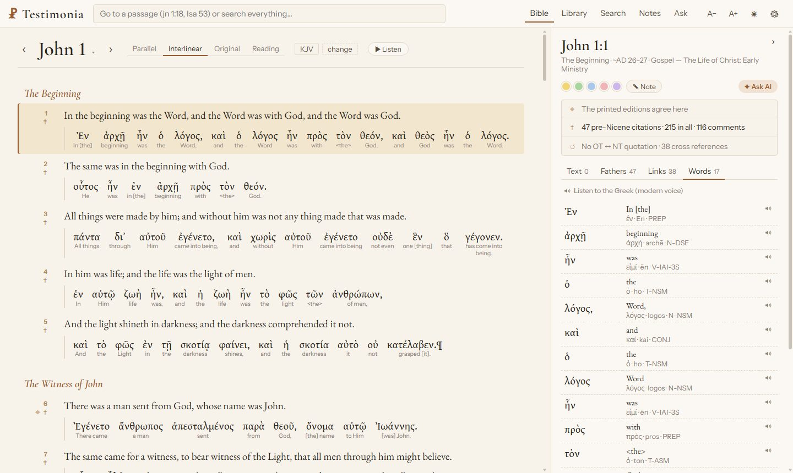
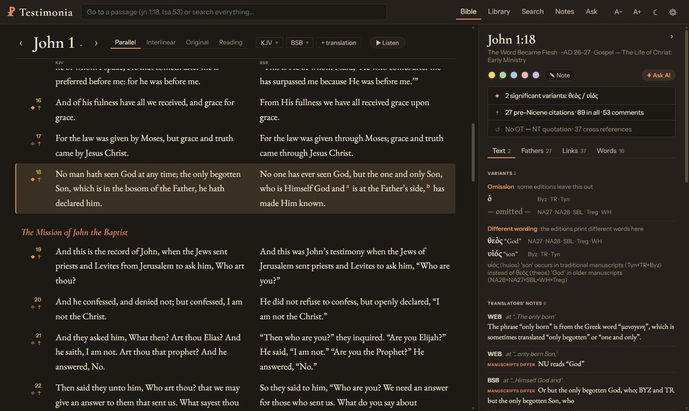
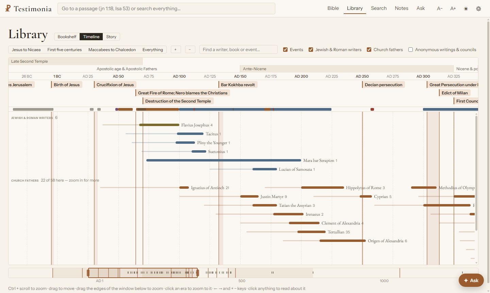
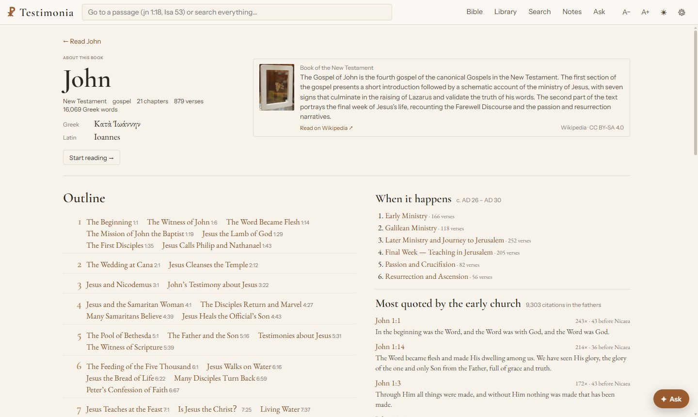

<p align="center">
  
</p>

<h1 align="center">Testimonia</h1>

<p align="center">
  <strong>The Bible and its earliest witnesses.</strong><br>
  An open-source study library for the Hebrew and Greek Scriptures, their translations, the manuscripts that
  carry them, and the first Christian writers who quoted them. Built entirely on open data.
</p>

<p align="center">
  <a href="LICENSE"></a>
  <a href="DATA_LICENSE.md"></a>
  
  
  
</p>

<p align="center">
  <a href="https://sammyboi1801.github.io/testimonia/"><strong>Website</strong></a> ·
  <a href="#quick-start">Quick start</a> ·
  <a href="docs/DEPLOY.md">Deploy</a> ·
  <a href="CREDITS.md">Credits</a> ·
  <a href="docs/DATA_MODEL.md">Data model</a>
</p>

<p align="center">
  
</p>

*Testimonia* were the collections of scriptural "witnesses" compiled by the earliest Christians. This project
gathers every kind of witness to the biblical text in one place: the Hebrew and Greek texts and their ancient
translations, the variants between the editions, and the writers of the first centuries who quoted, explained and
debated them, each placed in time.

## Features

| | |
|---|---|
| **Read** | Thirteen translations side by side (KJV, Geneva, Tyndale, Douay–Rheims, Brenton's Septuagint, the Vulgate, WEB, BSB and more), aligned verse by verse, with an interlinear of every Greek and Hebrew word, the translators' own footnotes, red letters, and read-aloud that carries on from chapter to chapter. |
| **Study a verse** | One panel per verse: where the printed editions differ and what each difference means, the church fathers who quoted it (pre-Nicene first), Josephus, Tacitus and other Jewish and Roman writers, cross references, and every word with its lexicon entry and grammar. |
| **Library** | Early Christian writings as a bookshelf, an interactive timeline beside the events that shaped them (Ctrl + scroll to zoom), or a century-by-century story, with Wikipedia previews for writers, works, events and books. |
| **Passage guide** | Everything about a whole passage on one page (e.g. John 1:1–18): variants verse by verse, the writers who quote it, the strongest cross references, notes, topics and setting. Compare translations word by word, and copy any verse or passage with its citation. |
| **Original languages** | Grammar search (every aorist passive of λύω; θεός without the article in John), word studies with an occurrence chart by book, meanings by semantic domain with related words (Louw–Nida, SDBG/SDBH), and Hebrew ↔ Septuagint equivalents. |
| **Manuscripts** | 2,070 manuscripts: NT papyri, majuscules and minuscules, Septuagint codices and the Dead Sea Scrolls, with dates, contents and holding libraries; for each verse, the earliest manuscripts containing it, with links to their images on NTVMR. |
| **Gospel parallels** | A synopsis of 152 sections with Matthew, Mark, Luke and John side by side, each Gospel's own wording highlighted, in English or Greek. |
| **People and places** | An atlas of 1,300 biblical places on a local map (no tracking tile servers), Paul's journeys, and pages for 3,000 biblical people (with families), places and events. |
| **Topics and plans** | A 5,300-topic concordance with pages per topic, and reading plans: the Bible in a year, chronological, the New Testament in 90 days, and "as the early church read it". |
| **Book pages** | An introduction, outline, setting and chronology for every book, and the passages the early church quoted most. |
| **Notes** | Highlight verses, words or phrases and write notes. Everything stays in your browser: no account, with export and import. |
| **Assistant** | Optional and bring-your-own-key: Anthropic, OpenAI, Gemini, OpenRouter, Groq, DeepSeek, Mistral, any OpenAI-compatible endpoint, or a model on your own machine (Ollama, LM Studio). It works through 17 tools over the whole library (passages, variants, the fathers, grammar search, manuscripts, people and places, topics, Gospel parallels, word meanings, and Wikipedia for background) and cites what it finds. Answers stream live; keys are never stored on the server. |
| **Anywhere** | Works on phones; colours, fonts, verse marks and panels are adjustable, in light and dark. |

<table>
  <tr>
    <td width="50%"></td>
    <td width="50%"></td>
  </tr>
  <tr>
    <td align="center"><sub>Variants explained: “God” or “Son” at John 1:18</sub></td>
    <td align="center"><sub>The library on a timeline</sub></td>
  </tr>
  <tr>
    <td colspan="2"></td>
  </tr>
  <tr>
    <td colspan="2" align="center"><sub>A book page: outline, when it happens, and the verses the early church quoted most</sub></td>
  </tr>
</table>

## Quick start

Requirements: Python 3.11+, Node 20+ and a few GB of disk.

```bash
git clone https://github.com/sammyboi1801/testimonia.git && cd testimonia
pip install -e .
python -m testimonia fetch --phase 0      # download the sources (~560 MB, pinned versions)
python -m testimonia build                # build the database (validated before it replaces the old one)
cd web && npm ci && npm run build && cd ..
python -m testimonia serve --open         # http://127.0.0.1:8765
```

Data is kept outside the repository, in `~/TestimoniaData` (override with `TESTIMONIA_DATA`); see
[`testimonia/config.py`](testimonia/config.py) for every setting. `python -m testimonia info` shows paths and row counts.

**Docker.** `docker build -t testimonia .` then
`docker run -p 7860:7860 -v ~/TestimoniaData/build:/data/build testimonia` serves an existing database.

**Hosting it.** [`docs/DEPLOY.md`](docs/DEPLOY.md) covers a free, always-on setup (an Oracle Cloud Always Free VM,
public through Tailscale Funnel or Caddy, with a one-command installer) and the static landing page in
[`site/`](site/), which GitHub Pages publishes automatically.

## What is in the database

| Layer | Content |
|---|---|
| Translations | KJV with Apocrypha, WEB (with deuterocanon), BSB, ASV, YLT, Darby, Webster, LSV, Geneva 1599, Tyndale NT, Douay–Rheims, Brenton's Septuagint, Clementine Vulgate; mapped onto one verse numbering with STEPBible's TVTMS rules, native numbering preserved; translators' footnotes from the USFM sources |
| Original languages | Leningrad Codex reading text; every Greek NT and Hebrew/Aramaic OT word with lemma, gloss, morphology and morphemes |
| Text criticism | About 15,500 variant units: where the printed Greek editions differ (meaning, omission, word order, spelling), Hebrew Ketiv/Qere and manuscript readings |
| Lexicons | STEPBible brief lexicons, Abbott-Smith, LSJ, BDB; Greek and Hebrew morphology codes; semantic domains and senses (MACULA with the UBS SDBG/SDBH) and Septuagint equivalents |
| Manuscripts | 2,070 manuscripts (NT papyri, majuscules, minuscules, LXX codices, Dead Sea Scrolls) with dates, contents as verse ranges, institutions and image links |
| People and places | 1,300 places with coordinates and verse references (OpenBible.info), 3,000 biblical people with family relations, events and Paul's journeys (Theographic) |
| Gospel parallels | 152 synoptic sections (BTB pericopes) with word-level agreement from the UBS Parallel Passage Database |
| Early writers | Ante-Nicene and Nicene/Post-Nicene Fathers with their scripture citations linked to verses (local builds, see below); Josephus, Tacitus, Suetonius, Pliny and Lucian; patristic comments arranged by verse (about 55,000 in the shareable build) |
| Study aids | 345,000 voted cross references, Treasury of Scripture Knowledge, pericope headings, Old Testament quotations in the New, a 5,300-topic concordance, red letters |
| Chronology | Era, period, approximate date and reading order for every verse; dated writers, works and events; six canon traditions and nine chronology systems |

## Data and licensing

Testimonia only ingests **openly licensed data**: public domain, CC0, CC BY or CC BY-SA. Every dataset and the
credit line its licence requires is listed in **[CREDITS.md](CREDITS.md)**, generated from
[`sources/sources.yaml`](sources/sources.yaml), the single source of truth. The rules are in
[`DATA_LICENSE.md`](DATA_LICENSE.md).

Used today: [STEPBible data](https://github.com/STEPBible/STEPBible-Data) (Tyndale House),
[Open Scriptures Hebrew Bible](https://github.com/openscriptures/morphhb), [eBible.org](https://ebible.org/),
the [Bruhman Translator's Bible](https://github.com/revjude/BTB), [OpenBible.info](https://www.openbible.info/),
the [HistoricalChristianFaith commentaries](https://github.com/HistoricalChristianFaith/Commentaries-Database),
[Perseus](https://www.perseus.tufts.edu/) and [Project Gutenberg](https://www.gutenberg.org/),
[Theographic](https://github.com/robertrouse/theographic-bible-metadata) (people, events, Paul's journeys),
[Natural Earth](https://www.naturalearthdata.com/) (the atlas basemap),
[MACULA](https://github.com/Clear-Bible) (semantic domains and Septuagint equivalents), the
[UBS open resources](https://github.com/ubsicap/ubs-open-license) (Gospel parallels), Wikipedia's manuscript and
Dead Sea Scrolls lists (pinned revisions), and Wikipedia summaries fetched live. The church fathers' texts come
from [CCEL](https://www.ccel.org/) and are used in local builds only (`testimonia build --public` leaves them out).
Manuscript images are linked on [NTVMR](https://ntvmr.uni-muenster.de), never copied.

Planned: SBLGNT and the Byzantine text, CNTR and INTF transcriptions, the Septuagint (Swete), Pleiades and
Wikidata, and Roman roads (Itiner-e).

## Roadmap

| Area | Next |
|---|---|
| Manuscripts | Transcriptions (CNTR, INTF), Masoretic codices, Dead Sea Scrolls mapped to English verse numbers |
| Texts | SBLGNT and the Byzantine text, the Greek Septuagint (Swete) |
| Context | Roman roads on the atlas, kings and rulers, canon history |
| Personal | Obsidian-compatible export, your own translation |

## Development

```bash
python -m venv .venv && . .venv/Scripts/activate   # Windows; use .venv/bin/activate elsewhere
pip install -e ".[dev]"
pytest                                             # tests
ruff check . && ruff format --check .              # lint and format
mypy testimonia                                    # types
python -m testimonia credits --check               # CREDITS.md matches sources.yaml

cd web && npm ci
npm run dev                                        # http://localhost:5173, proxying /api to the Python server
npx tsc -b && npx vitest run                       # types and tests
```

Issues and pull requests are welcome. New data must come from an openly licensed source and be declared in
[`sources/sources.yaml`](sources/sources.yaml).

## Licence

Code: [MIT](LICENSE). Data: a built database is CC BY-SA 4.0 as a combination of its sources; see
[DATA_LICENSE.md](DATA_LICENSE.md) and [CREDITS.md](CREDITS.md).
